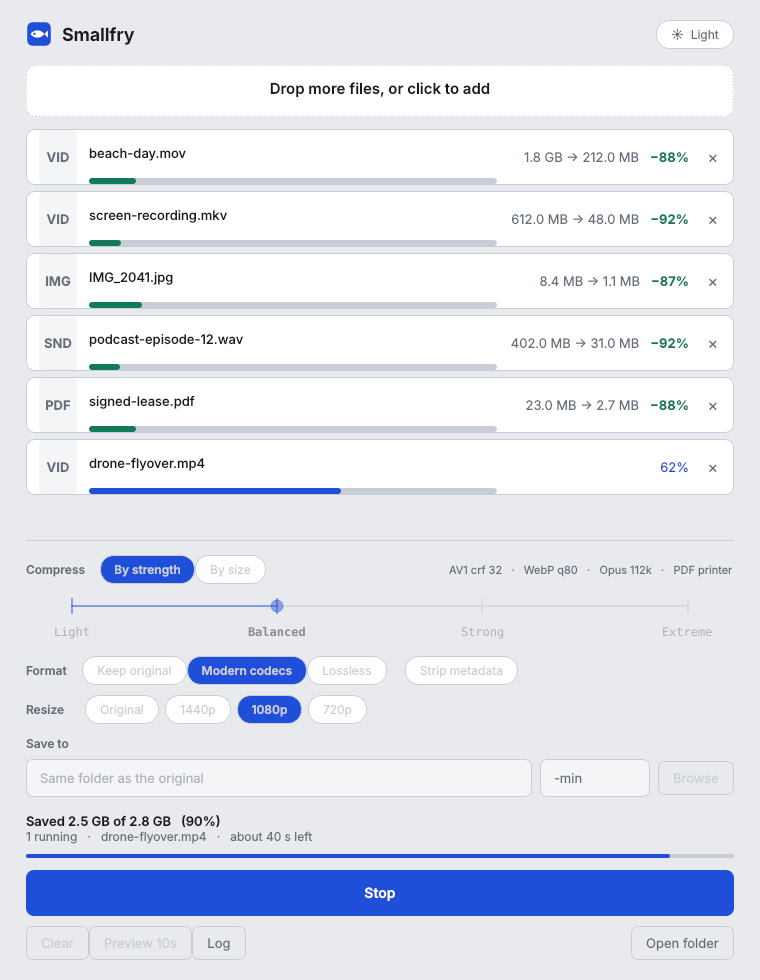

<div align="center">


# Smallfry

**Drop files in, get smaller files out.**

A batch compressor for video, images, audio and PDFs on Linux.<br>
Native Qt 6, powered by ffmpeg. One queue, one button, originals never touched.

<br>

<picture>
  <source media="(prefers-color-scheme: dark)" srcset="docs/screenshot-dark.png">
  
</picture>

</div>

<br>

## Why

You have a video that's too big to send, a folder of phone photos eating your
disk, or a scanned PDF an upload form won't take. Smallfry takes all of them in
one queue and makes them smaller, without you having to remember a single
ffmpeg flag.

- **Everything in one place.** Video, images, audio and PDFs, mixed in the same batch.
- **By strength or by size.** Pick Light, Balanced, Strong or Extreme, or type a
  target like *25 MB* and Smallfry works out the settings to hit it.
- **Modern codecs when you want them.** AV1 video, WebP images, Opus audio. Or keep
  the original formats so everything still opens everywhere.
- **Lossless mode.** Repacks files with no quality change at all.
- **Uses your GPU.** NVIDIA NVENC when there's a card, with an automatic fallback
  to the CPU if the GPU refuses a file.
- **Resize while you're at it.** Cap videos and photos at 1440p, 1080p or 720p.
  Usually the biggest saving of all, and nothing is ever enlarged.
- **Photos keep their tags.** Date, camera and location carry over to the
  compressed copy (with `exiftool` installed), and the picture stays the right
  way up. Or switch on *Strip metadata* to remove them.
- **Fast on big batches.** Video, GPU and small jobs each get their own lane, so
  photos and audio finish while a long video is still encoding.
- **Preview first.** Encode a 10-second sample of a video and see the projected size.
- **Originals are never modified.** Results go next to the original with a `-min`
  suffix, or into a folder you choose, and never overwrite another file.

## Install

### Arch / CachyOS

```sh
git clone https://github.com/devbnkdr/Smallfry.git
cd Smallfry
./install.sh
```

The installer pulls in `python-pyqt6` and `ffmpeg` with pacman. It then installs
Smallfry for your user only:

- the app in `~/.local/share/smallfry/`
- a `smallfry` launcher in `~/.local/bin/`
- a desktop entry and icon, so it shows up in your app launcher

For PDFs and lossless image passes, also install the optional helpers:

```sh
sudo pacman -S --needed ghostscript qpdf oxipng libjpeg-turbo perl-image-exiftool
```

Run `./install.sh --uninstall` to remove it all again.

### Any other distro

Install **ffmpeg** (and optionally `ghostscript`, `qpdf`, `oxipng`, `libjpeg-turbo`,
`exiftool`) from your package manager, then:

```sh
pipx install git+https://github.com/devbnkdr/Smallfry.git
```

You can also run it straight from a checkout with `python3 smallfry.py`, as long
as `PyQt6` is importable.

## Use

```sh
smallfry                         # empty window: drop files in
smallfry ~/Videos/clip.mp4       # start with a file in the queue
smallfry ~/Pictures/holiday/     # or a whole folder
```

1. Drop files or folders anywhere on the window, or click the drop area to browse.
2. Choose **By strength** or **By size**, a **Format**, and optionally **Resize**.
   Each queued file shows what it will become, like *→ WEBP · 1080p*.
3. Press **Compress**.

Double-click a finished row to open the result. Right-click for more: show it in
its folder, compress it again, or cancel just that one job. Hover a failed row
to see why it failed. When a batch finishes in the background, you get a desktop
notification.

Your choices are remembered for next time.

### What each setting does

| Strength | Video (AV1 / H.265) | Images (WebP / JPEG) | Audio (Opus / MP3) | PDF |
|---|---|---|---|---|
| Light | CQ 26 / 22 | quality 92 / q 3 | 160 / 224 kbps | prepress |
| Balanced | CQ 32 / 27 | quality 80 / q 6 | 112 / 160 kbps | printer |
| Strong | CQ 38 / 32 | quality 66 / q 10 | 80 / 128 kbps | ebook |
| Extreme | CQ 44 / 37 | quality 50 / q 15 | 56 / 96 kbps | screen |

| Resize | Video | Photos |
|---|---|---|
| 1440p | short side ≤ 1440 | long side ≤ 2560 |
| 1080p | short side ≤ 1080 | long side ≤ 1920 |
| 720p | short side ≤ 720 | long side ≤ 1280 |

| Format | Video | Images | Audio | PDF |
|---|---|---|---|---|
| Keep original | H.265 in the same container | same format | MP3 | Ghostscript |
| Modern codecs | AV1 in MP4 (H.265 without an AV1 encoder) | WebP | Opus | Ghostscript |
| Lossless | remux, no re-encode | oxipng / jpegtran | WAV → FLAC, others copied | qpdf |

**By size** solves for a bitrate on video and audio, and searches the quality
scale on images (PNG, BMP and TIFF are saved as JPEG, since they have no quality
setting to search). PDFs use the strongest preset, since Ghostscript can't aim
at a size. A file that can't reach the target is marked *missed target*.

### Keyboard

| Key | Action |
|---|---|
| `Ctrl+O` | Add files |
| `Ctrl+Return` | Start / stop |
| `Ctrl+L` | Show / hide the log |
| `Ctrl+D` | Switch light / dark |
| `Ctrl+M` | Minimise |
| `Ctrl+Q` / `Ctrl+W` | Quit |

## How it behaves

- **A result that isn't smaller is thrown away** and the row says *already small*.
  With a size target, files already under it are left alone.
- **Stopping or closing mid-batch** kills the running encodes and deletes their
  half-written files. Settings are locked while a batch runs, so every file in
  it is treated the same.
- **Jobs run in three lanes:** up to two NVENC encodes, one to three CPU video
  encodes (each already uses every core), and up to eight images, audio files
  and PDFs alongside them.
- **The GPU is used only when it's there.** NVENC is picked when the NVIDIA driver
  is loaded. If a file still fails on the GPU, it's retried once on the CPU and
  the row is marked *cpu*.
- **Audio in video** is re-encoded at 128 kbps. MKV subtitles are copied
  across. Other data streams and chapters are dropped.
- **Lossless video** is a straight remux: every stream is copied as is, so it
  mostly helps with badly muxed files.
- **Strip metadata** removes tags such as titles, dates and location where the
  format carries them. It's off by default. Photo tags are carried over only when
  compressing by strength; with a size target they'd push the file over it.
- Settings are saved in `~/.config/smallfry/`.

## Development

```sh
pip install PyQt6 pytest ruff
ruff check .
QT_QPA_PLATFORM=offscreen pytest

# regenerate the screenshots in docs/
QT_QPA_PLATFORM=offscreen python3 scripts/screenshots.py
```

Smallfry is a single file, `smallfry.py`, on purpose. Keep it that way.

## License

Smallfry is free and open source under the [MIT License](LICENSE).
Copyright © 2026 devbnkdr.

You can use, copy, change and share it, including commercially, as long as the
copyright and license notice stay with it.

## Disclaimer

Smallfry is provided **"as is", without warranty of any kind**, express or
implied, including the warranties of merchantability, fitness for a particular
purpose and non-infringement. In no event shall the author be liable for any
claim, damages or other liability arising from the software or its use. The
[license](LICENSE) has the full terms.

In plain words:

- **Check your results before deleting originals.** Smallfry never writes over
  the files you add and never overwrites an existing file, but compression is
  lossy unless you pick *Lossless*, and video tools can fail in odd ways on odd
  files. Keep backups of anything that matters.
- **You're responsible for what you compress.** Make sure you have the right to
  modify and share the media you work on.
- **Third-party software is under its own terms.** Smallfry calls
  [FFmpeg](https://ffmpeg.org/legal.html), [Ghostscript](https://www.ghostscript.com/licensing/)
  (AGPL), [qpdf](https://qpdf.sourceforge.io/), [oxipng](https://github.com/shssoichiro/oxipng)
  jpegtran and [ExifTool](https://exiftool.org/), and uses [Qt / PyQt6](https://www.riverbankcomputing.com/software/pyqt/) (GPL).
  It doesn't include any of them; you install them yourself. Some codecs, such
  as H.264, HEVC and AAC, may be patent-encumbered where you live.
- NVIDIA and NVENC are trademarks of NVIDIA Corporation. Smallfry isn't
  affiliated with or endorsed by NVIDIA, the FFmpeg project, Artifex or
  Riverbank Computing.
